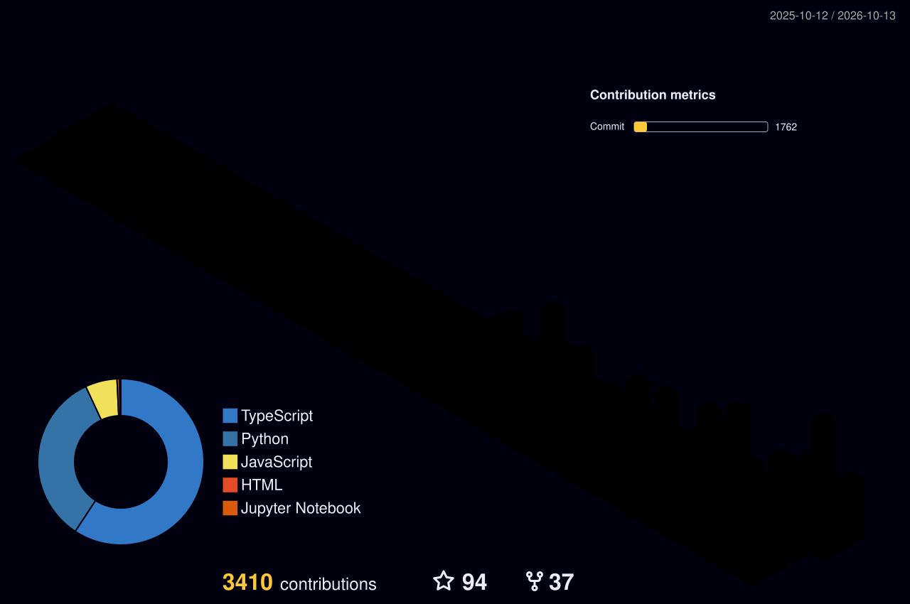

# Zhao Wen

  Python · TypeScript · Multi-Agent · MCP · Atmospheric Data Fusion · Literature

  

  
   
  李白《把酒问月》

  
  
  

---

## 👋 About Me

你好，我是 Zhao Wen，主要在 AI 工程与大气环境科研之间工作，也喜欢文学、游戏、骑行、跑步和到处闲逛。

- 🔭 正在构建 **本地优先的 AI 工具、多 Agent 系统与 MCP 服务**
- 🌫️ 长期研究 **空气质量监测-模型数据融合、WRF-CMAQ 与健康效益评估**
- 🧭 关注 **可复用、可验证、可自动化** 的工具与研究流程
- 📍 Guangdong, China

> I build practical systems at the intersection of **AI engineering** and **atmospheric science**.

## 🔗 Social accounts

- 📧 Email: [1473517806@qq.com](mailto:1473517806@qq.com)

## 🛠️ Tech Stack

  
  
  
  
  
  
  
  

## ⭐ Featured Projects

### AI / LLM Engineering

| Project | Description |
| --- | --- |
| [zhaowen-mcp](https://github.com/zhuobichen/zhaowen-mcp) | 个人 MCP 服务集合（15 个）：中文平台数据、会话检索、代码审阅、识图生图生视频、用量监测。 |
| [zhaowen-dsh](https://github.com/zhuobichen/zhaowen-dsh) | DSH 工具集：多 Agent 团队编排插件、Claude Code 风格 TUI 与终端客户端。 |
| [zhaowen-cli](https://github.com/zhuobichen/zhaowen-cli) | CLI 小工具集：OneNote 读取 / Windows 便签 / 智能体对话管理（原三库合并，历史完整保留）。 |
| [weflow-cli](https://github.com/zhuobichen/weflow-cli) | 本地优先的微信数据工具：聊天记录、公众号日报、个人知识库与 MCP。 |
| [pilgrim-intel](https://github.com/zhuobichen/pilgrim-intel) | 统一 AI 情报聚合系统：多信源抓取、AI 摘要与 MCP 可查询。 |
| [zhaowen-claudemod](https://github.com/zhuobichen/zhaowen-claudemod) · [zhaowen-codexplugin](https://github.com/zhuobichen/zhaowen-codexplugin) | Claude Code / Codex 插件市场（skill + hooks + MCP 工具）。 |
| [MathModeling-Agent](https://github.com/zhuobichen/MathModeling-Agent) | 数学建模竞赛数据分析题全流程自动化系统（多 Agent 流水线）。 |
| [PPT_Control](https://github.com/zhuobichen/PPT_Control) | 基于 Markdown 模板与提示词的 PPT 自动化组装工作台。 |
| [digital-humanities-narrative](https://github.com/zhuobichen/digital-humanities-narrative) | 数字人文叙事 AI 分析引擎：人物关系网络与叙事生成（CLI + Web）。 |
| [Ember](https://github.com/zhuobichen/Ember) | 从聊天记录中用 AI 生成人生纪念碑的数字悼亡工具。 |
| [ai-job-command-center](https://github.com/zhuobichen/ai-job-command-center) | AI 驱动的本地求职助手（面向中国招聘市场）。 |
| [qchat-cli](https://github.com/zhuobichen/qchat-cli) · [server_manager](https://github.com/zhuobichen/server_manager) | 轻量 CLI 小工具。 |

### Atmospheric Science

| Project | Description |
| --- | --- |
| [PM25-Fusion-AutoResearch](https://github.com/zhuobichen/PM25-Fusion-AutoResearch) | PM2.5 监测-模型数据融合自动研究框架（VNA / eVNA / aVNA / Downscaler 复现与验证）。 |
| [guangdong-wrf-cmaq](https://github.com/zhuobichen/guangdong-wrf-cmaq) | 广东省 WRF-CMAQ 空气质量多尺度模拟与评估。 |

> 私有主库：**integrated-air-quality-lab**（LIAE 实验室主代码库：WRF/CMAQ、DeepRSM、数据融合、CO2 反演，另收编 5 个存档项目）· **ABaCAS** · **DataFusion_EPAproject** · **hcyx** · **Agent_Paper**（论文工作台）

### 私有项目线（仅列名，不设链接）

**lingtai-reader**（纯本地电子书阅读器 + 内置藏书库）· **ZhaoWen_KnowledgeBase**（个人知识库）· **AndroidApps**（MapMate 骑行导航助手）· **ZhaoWenGitHubDiary**（账号级仓库变更留痕账本）

## 🧭 Code Observatory

  

  

## 🌌 Contribution in 3D

  

  Code, research, and a little moonlight.

